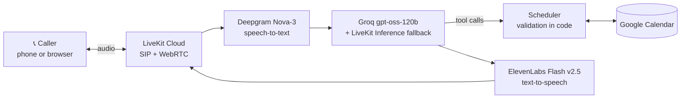

# 📞 Aria — AI Voice Receptionist

A real-time voice agent that answers calls for a small business, understands what the caller wants,
and **books, cancels and reschedules appointments in Google Calendar** while they're on the line.

**[▶ Demo video](https://youtu.be/REPLACE)** · **[🌐 Talk to Aria in your browser](https://REPLACE.vercel.app)** · **📞 +1 (REPLACE) — call her**

> Built in 7 days as a portfolio project. The demo is configured as *Sunrise Dental Clinic*;
> switching to a coaching centre, salon or dealership is a single YAML file.

## Results

| Metric | Value |
|---|---|
| Median response latency (caller stops → Aria speaks) | **REPLACE s** (p95 REPLACE s) |
| Task completion, automated conversation tests | **REPLACE %** over REPLACE conversations |
| Unit tests | 123 passing |

How these are measured, plus failed-conversation analysis: [`docs/metrics.md`](docs/metrics.md).

## What Aria can do

- **Answer** questions about hours, services, location and policies, from `config/business.yaml`
- **Book** appointments: checks real free slots, collects name and number, reads back, books on "yes"
- **Handle taken slots** by offering the three nearest free times
- **Cancel and reschedule** by the phone number the booking was made with
- **Talk naturally:** handles interruptions, mid-sentence pauses, silence ("are you still there?"),
  mishearings ("sorry, did you say…?") and changes of mind
- **Use caller ID** on phone calls: "Shall I use the number you're calling from?"
- **Hang up politely** when the caller says goodbye

## Architecture



Booking sequence and component details: [`docs/architecture.md`](docs/architecture.md).

## Design decisions

**The LLM proposes, the code decides.** Every tool call is validated in Python before it touches
the calendar: opening hours, closed days, booking horizon, service duration, 10-digit phone numbers,
and a lock plus re-check against double-booking. Booking, cancelling and rescheduling only run
after the caller's last reply was a clear "yes".

**Some decisions were taken away from the LLM.** Testing showed a small model calling the end-call
tool right after the caller gave their name, and inventing a phone number by copying the prompt's
examples. So hanging up is decided by code (goodbye detection), every reply is cut after its first
question, and the prompt contains no example values to copy.

**Latency is measured, not guessed.** Every turn is timed end-to-end and split into endpointing,
LLM and TTS, which showed that most of the delay was the wait to be sure the caller had finished,
not the model.

**It degrades gracefully.** If Groq rate-limits, a fallback LLM answers. If Google Calendar is
down, Aria apologises and takes a message. A time limit protects API credits on the public demo.

**Logs mask phone numbers** (`******3210`).

## Tech stack

| Layer | Choice |
|---|---|
| Voice pipeline, telephony, hosting | [LiveKit Agents](https://docs.livekit.io/agents/) 1.8 on LiveKit Cloud |
| Speech-to-text | Deepgram Nova-3, with keyterms from the business config |
| LLM | Groq `openai/gpt-oss-120b`, falling back to LiveKit Inference |
| Text-to-speech | ElevenLabs Flash v2.5 |
| Calendar | Google Calendar API (service account) |
| Web demo | LiveKit `agent-starter-react` on Vercel |

## Project structure

```
├── main.py                     # Entry point: console | dev | start
├── Dockerfile                  # LiveKit Cloud image
├── config/business.yaml        # The business: hours, services, policies, persona
├── receptionist/
│   ├── agent.py                # Agent: tools, guards, call tracking
│   ├── providers.py            # STT / LLM / TTS / turn-taking / scheduler from config
│   ├── prompts/receptionist.md # Persona prompt template
│   ├── scheduling.py           # Hours, slots, validation (pure)
│   ├── scheduler.py            # check / book / find / cancel / reschedule
│   ├── calendar_client.py      # Google Calendar + in-memory calendar
│   ├── call_control.py         # Goodbye + "yes" detection
│   ├── reply_guard.py          # One question per turn
│   ├── caller_id.py            # Phone caller's number
│   ├── latency.py, call_record.py, metrics.py   # Measurement
│   └── evals.py                # Automated conversation scenarios
├── scripts/                    # check_env, check_calendar, chat, run_evals, metrics_report
├── tests/                      # 123 unit tests (no network needed)
├── deploy/                     # Dispatch rule, production secrets template
└── docs/                       # Architecture, metrics, deployment, demo script, progress log
```

## Run it locally

Requirements: Python 3.10–3.14 (3.12 recommended), with your PC clock set to sync automatically,
plus free accounts at [LiveKit Cloud](https://cloud.livekit.io), [Deepgram](https://deepgram.com),
[Groq](https://console.groq.com) and [ElevenLabs](https://elevenlabs.io), and a Google Cloud
service account for the calendar ([setup](#google-calendar-setup)).

```bash
git clone https://github.com/<you>/<repo>.git && cd <repo>
python -m venv .venv
.venv\Scripts\activate              # mac/Linux: source .venv/bin/activate
pip install -r requirements-dev.txt
copy .env.example .env.local         # mac/Linux: cp — then fill in your keys

python scripts/check_env.py          # everything [OK]?
python scripts/check_calendar.py --test-book
python main.py console               # talk to Aria through your mic
```

No Google setup yet? Set `CALENDAR_PROVIDER=memory` to use a temporary in-memory calendar.

### Google Calendar setup

1. Google Cloud Console → new project → enable the **Google Calendar API**.
2. IAM → Service Accounts → create one → Keys → JSON. Save it as
   `credentials/google-service-account.json` (git-ignored).
3. Create a calendar (time zone = the business's) and share it with the service account's email
   with **Make changes to events**.
4. Put the calendar's ID in `GOOGLE_CALENDAR_ID`.

## Testing and evaluation

```bash
pytest                                       # 123 unit tests, offline
python scripts/run_evals.py --repeat 3       # scripted callers vs the real LLM
python scripts/metrics_report.py --failed    # latency, completion, failures -> docs/metrics.md
```

The eval suite covers 11 scenarios: happy-path booking, taken slot, change of mind, incomplete
request, short phone number, no confirmation, closed day, unknown service, cancel, cancel with the
wrong number, and reschedule. Each passes only if the calendar ends in the right state.

## Deployment

Agent on LiveKit Cloud, phone number, and web demo on Vercel: [`docs/deploy.md`](docs/deploy.md).

## Customise for another business

Edit `config/business.yaml`: name, hours, services and durations, policies, receptionist name,
greeting and farewell. The prompt, speech-recognition keyterms and booking rules all follow from it.

## Limitations and next steps

- LiveKit's own phone numbers are US-only; an Indian number needs a SIP provider (see deploy guide).
- English only. Deepgram and ElevenLabs support Hindi, which is a natural next step.
- No SMS or WhatsApp confirmation after booking yet.
- A caller is identified by phone number only; a production version would add verification.

## Build log

Built day by day; decisions, bugs found in testing and their fixes: [`docs/progress.md`](docs/progress.md).
