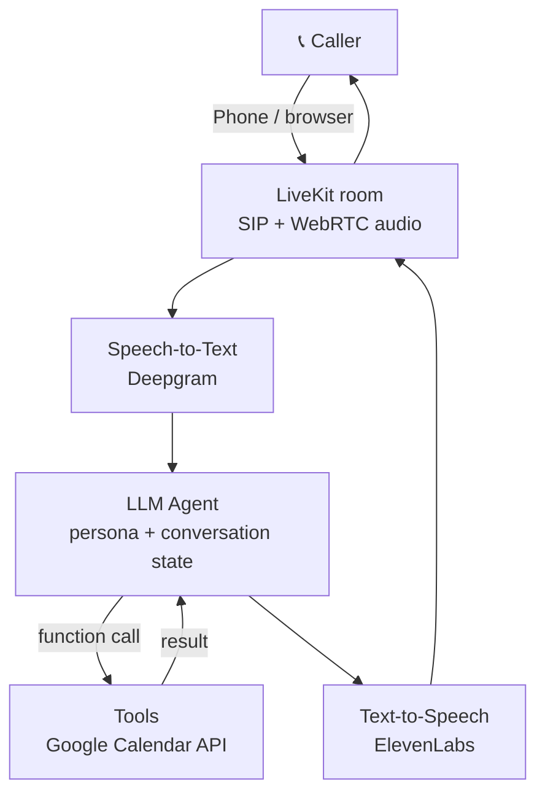

# Architecture

## Components

| File | Responsibility |
|---|---|
| `main.py` | Starts the LiveKit agent server |
| `receptionist/agent.py` | Builds the STT → LLM → TTS session for each call, logs the conversation |
| `receptionist/persona.py` | Turns `config/business.yaml` + the prompt template into LLM instructions |
| `receptionist/config.py` | Reads secrets and model choices from `.env.local` |
| `receptionist/tools/` | Function-calling tools the LLM can use (Day 4) |

## Design decisions

- **Business data lives in YAML, not code.** Switching from a dental clinic to a coaching centre means editing one file.
- **Fixed greeting via `session.say()`.** The first words play instantly instead of waiting on the LLM.
- **Model choices are environment variables.** Swapping providers (Day 2 and 3) doesn't touch the agent logic.
- **Persona module has no LiveKit dependency,** so it is unit-tested in milliseconds.
