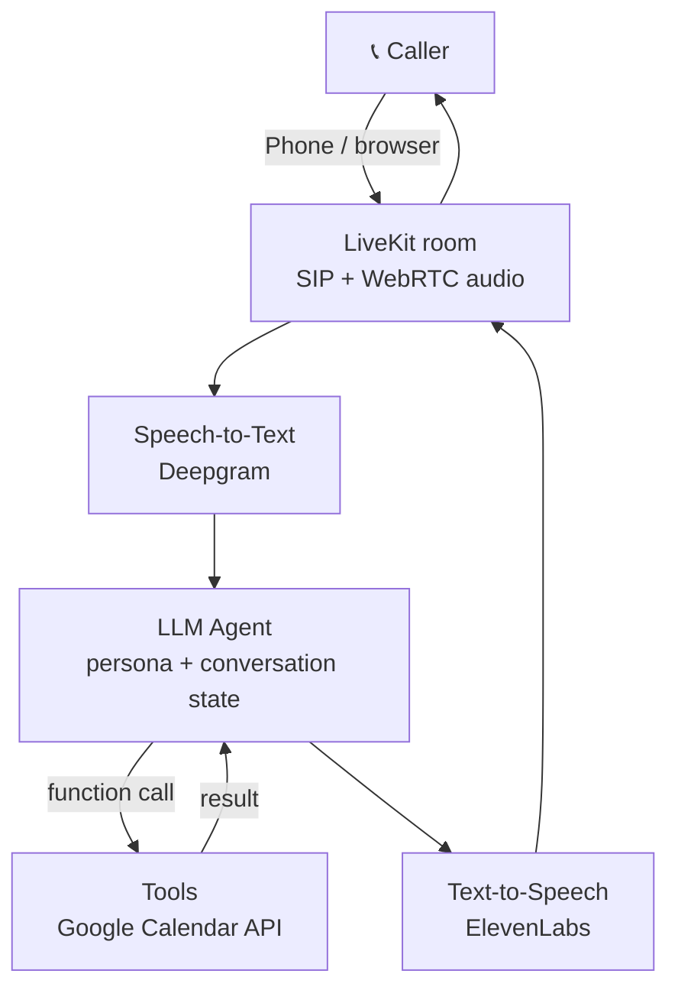
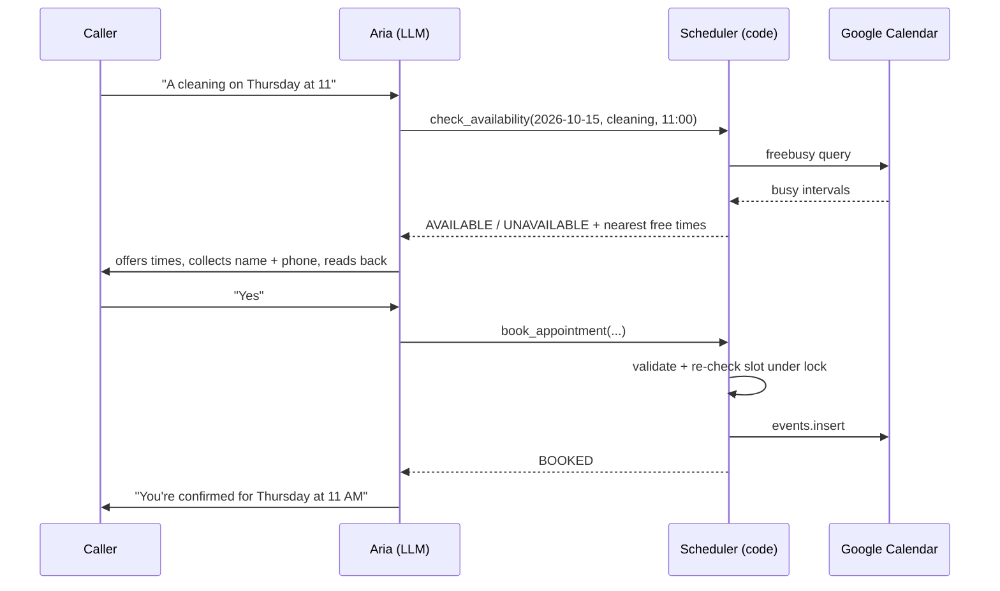

# Architecture

## Components

| File | Responsibility |
|---|---|
| `main.py` | Starts the LiveKit agent server |
| `receptionist/agent.py` | Builds the STT → LLM → TTS session for each call, logs the conversation |
| `receptionist/persona.py` | Turns `config/business.yaml` + the prompt template into LLM instructions |
| `receptionist/config.py` | Reads secrets and model choices from `.env.local` |
| `receptionist/scheduling.py` | Opening hours, slot generation, validation (pure, unit-tested) |
| `receptionist/scheduler.py` | `check_availability` / `book` used by the LLM tools |
| `receptionist/calendar_client.py` | Google Calendar (service account) and in-memory calendar |
| `receptionist/call_control.py` | Goodbye detection (hang-up) and "yes" detection (booking guard) |
| `receptionist/reply_guard.py` | Cuts replies after the first question |
| `receptionist/caller_id.py` | Reads the phone caller's number from the SIP participant |
| `receptionist/call_record.py` / `metrics.py` | Per-call outcome tracking and the metrics report |
| `Dockerfile` / `deploy/` | LiveKit Cloud image, dispatch rule, production secrets template |

## Design decisions

- **Business data lives in YAML, not code.** Switching from a dental clinic to a coaching centre means editing one file.
- **Fixed greeting via `session.say()`.** The first words play instantly instead of waiting on the LLM.
- **Model choices are environment variables.** Swapping providers (Day 2 and 3) doesn't touch the agent logic.
- **Persona module has no LiveKit dependency,** so it is unit-tested in milliseconds.

## Booking flow

- **The LLM proposes, the code decides.** Invalid requests return `NOT BOOKED: <reason>` and the model asks again.
- **Google's client is synchronous**, so calls run in a worker thread with a 10s timeout and never block the audio loop.
- If the calendar is unreachable, tools return `ERROR` and Aria falls back to taking a message.
